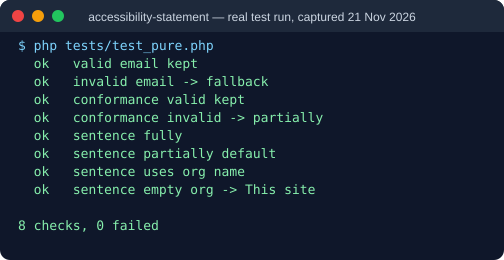

# Accessibility Statement (WordPress plugin) — manual

*One page, eight blocks. Every figure here comes from this repository's own tests and README.*

## 1. Claim
Publishes an honest WCAG 2.2 AA accessibility statement from a shortcode, with settings that are sanitised and capability-checked.

## 2. What it is
A WordPress plugin that creates an accessibility statement page and keeps its review date current. The organisation name, contact email and conformance level are set in the admin.

## 3. Demo
Install on a test site and visit `/accessibility`. Capture to record: the settings page and the rendered statement.


*Real output from this repository's own tests, captured 21 Nov 2026.*

## 4. Run it yourself
**Prerequisites:** WordPress 6.2+, PHP 7.4+.

```bash
php -l accessibility-statement.php
php tests/test_pure.php
# then upload to wp-content/plugins/ and activate
```

## 5. What you will see
Lint passes and the pure-function tests run. After activation, `/accessibility` exists and shows your settings.

## 6. 30-second talking point
> An accessibility statement should be honest and current. This plugin makes that the easy path, and I distilled and generalised it from the module running in production on Derry Training.

## 7. Scope and limits
- It publishes a statement; it does not audit a site. Conformance claims are the site owner's responsibility.

## 8. Links
[Repository](https://github.com/fhionnghaile/accessibility-statement) · [readme.txt](readme.txt)
